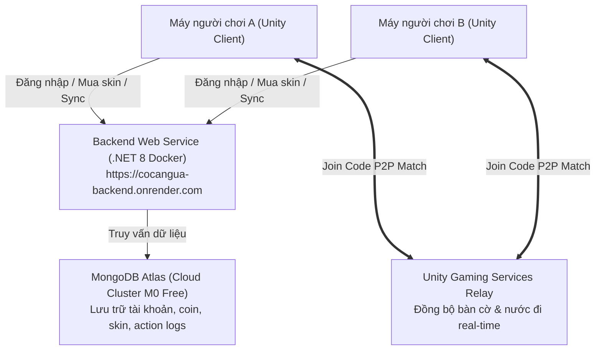

# HƯỚNG DẪN TRIỂN KHAI BACKEND LÊN CLOUD (RENDER + MONGODB ATLAS)
> **Mục tiêu:** Đưa toàn bộ hệ thống Server Game 3D Cờ Cá Ngựa lên Internet 24/7 hoàn toàn **MIỄN PHÍ**.  
> Người chơi chỉ việc mở game là chơi được ngay từ bất kỳ đâu trên thế giới, **KHÔNG CẦN BẬT NGROK, KHÔNG CẦN CHUNG MẠNG WIFI, KHÔNG CẦN CHẠY TERMINAL TRÊN MÁY TÍNH CÁ NHÂN**.

---

## 1. TỔNG QUAN KIẾN TRÚC CLOUD



---

## 2. BƯỚC 1: TẠO DATABASE MONGODB ATLAS (MIỄN PHÍ VĨNH VIỄN)

1. Truy cập trang chủ MongoDB Atlas: [https://www.mongodb.com/cloud/atlas](https://www.mongodb.com/cloud/atlas)
2. Đăng ký hoặc Đăng nhập bằng tài khoản **Google / GitHub**.
3. Bấm **Create a deployment** (hoặc Build a Database):
   - Chọn loại: **M0 (Free)**.
   - Name: Đặt tên tuỳ chọn (ví dụ: `Cluster0`).
   - Provider & Region: Chọn **AWS / Singapore (ap-southeast-1)** (gần Việt Nam nhất để ping thấp).
   - Bấm **Create Deployment**.
4. **Tạo tài khoản truy cập Database (Security):**
   - Username: `cocangua_admin`
   - Password: Nhập mật khẩu dễ nhớ nhưng an toàn (ví dụ: `AdminSecret2026!`). Bấm **Create Database User**.
5. **Mở quyền IP truy cập (Network Access):**
   - Chọn **Add IP Address** ➔ Bấm nút **Allow Access from Anywhere** (`0.0.0.0/0`).
   - Bấm **Confirm**. *(Bước này bắt buộc để server Render có thể kết nối vào MongoDB)*.
6. **Lấy chuỗi kết nối (Connection String):**
   - Bấm nút **Connect** (hoặc vào Database ➔ Connect).
   - Chọn **Drivers** (mục C# / .NET).
   - Copy chuỗi kết nối có dạng:
     ```text
     mongodb+srv://cocangua_admin:<password>@cluster0.xxxxx.mongodb.net/?retryWrites=true&w=majority&appName=Cluster0
     ```
   - Thay `<password>` bằng mật khẩu bạn đã tạo ở bước 4 (ví dụ: `AdminSecret2026!`).

---

## 3. BƯỚC 2: DEPLOY BACKEND LÊN RENDER.COM (HOÀN TOÀN MIỄN PHÍ)

1. Truy cập [https://render.com/](https://render.com/) và đăng nhập bằng tài khoản **GitHub**.
2. Trên màn hình Dashboard, bấm nút **New +** ở góc trên cùng bên phải ➔ Chọn **Web Service**.
3. **Kết nối kho lưu trữ GitHub:**
   - Chọn repository: `ngotrieuduy123-lab/3DCoCaNgua`.
   - Bấm **Connect**.
4. **Cấu hình Web Service:**
   - **Name:** `cocangua-backend` (hoặc tên bất kỳ bạn thích).
   - **Region:** `Singapore` (để kết nối nhanh nhất về Việt Nam).
   - **Branch:** Chọn nhánh `Minh`.
   - **Root Directory:** Để trống hoặc gõ `Backend`.
   - **Environment:** Chọn `Docker`.
   - **Dockerfile Path:** `Backend/Dockerfile`.
   - **Docker Context:** `Backend`.
   - **Instance Type:** Chọn **Free**.
5. **Thêm biến môi trường (Environment Variables):**
   Cuộn xuống phần **Environment Variables**, bấm **Add Environment Variable** và thêm 2 biến:
   - **Biến 1:**
     - Key: `ConnectionStrings__MongoDB`
     - Value: `<Dán toàn bộ chuỗi kết nối MongoDB Atlas đã lấy ở Bước 1>`
   - **Biến 2:**
     - Key: `DatabaseName`
     - Value: `GNS301_Lab_CoCaNgua`
6. Bấm nút **Create Web Service** ở cuối trang.
7. **Chờ Render build tự động (Khoảng 2 - 3 phút):**
   - Màn hình log sẽ tải Docker image, restore NuGet và publish .NET 8.
   - Khi thấy dòng:
     ```text
     ==> Your service is live 🎉
     ```
   - Render sẽ cấp cho bạn một domain HTTPS cố định vĩnh viễn ở đầu trang, ví dụ:  
     👉 **`https://cocangua-backend.onrender.com`**

---

## 4. BƯỚC 3: KIỂM TRA SERVER TRÊN TRÌNH DUYỆT

1. Mở trình duyệt truy cập vào link của bạn:
   - **Swagger API Docs:** `https://cocangua-backend.onrender.com/swagger`
   - **Web Admin Dashboard:** `https://cocangua-backend.onrender.com/`
2. Đăng nhập thử trang Admin: `admin` / `123456789`.
   - Thấy giao diện hiển thị danh sách người chơi và Live Terminal trơn tru là Server Cloud đã sẵn sàng 100%!

---

## 5. BƯỚC 4: CẬP NHẬT GAME UNITY ĐỂ CHƠI VĨNH VIỄN

Bạn có 2 cách để game kết nối vào Cloud:

### Cách 1: Chỉnh sửa file `server_config.txt` (Dành cho bản build có sẵn)
Mở file `server_config.txt` nằm kế bên file `.exe` của game và sửa thành:
```ini
BackendUrl=https://cocangua-backend.onrender.com
```

### Cách 2: Cài đặt làm URL mặc định trong code (Dành cho bản build chính thức)
Trong file `Assets/Scripts/Network/ServerConfig.cs`, chỉ cần đổi dòng mặc định:
```csharp
public static string BackendUrl { get; private set; } = "https://cocangua-backend.onrender.com";
```
Sau đó build game ra file `.exe`. Bạn chỉ việc nén file `.exe` gửi cho bạn bè hoặc đăng lên Google Drive/Itch.io. Bất cứ ai tải về mở lên là tự động kết nối vào Cloud Server và chơi được ngay!

---

> [!NOTE]
> **Lưu ý về gói Render Free:**
> Trên gói Free của Render, nếu không có request nào trong 15 phút, server sẽ tạm "ngủ" (Spin down) để tiết kiệm tài nguyên. Khi có người chơi đầu tiên mở game, server sẽ mất khoảng 30 - 50 giây để khởi động lại (Cold Start). Sau khi khởi động xong, game sẽ chạy mượt mà liên tục.
