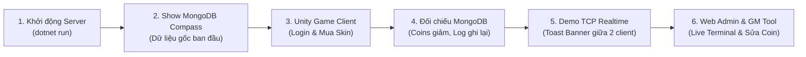

# TÀI LIỆU TỔNG HỢP KIẾN TRÚC HỆ THỐNG BACKEND, HƯỚNG DẪN KIỂM TRA & KỊCH BẢN DEMO
**Dự án:** 3D Cờ Cá Ngựa (Party Clash)  
**Tác giả:** Minh  
**Môn học:** GNS301 - Game Networking & Server (.NET 8 + MongoDB + TCP Socket + Unity)

---

## MỤC LỤC
1. [Tổng Hợp Những Gì Đã Làm](#1-tổng-hợp-những-gì-đã-làm)
2. [Cấu Trúc Thư Mục & Các Thành Phần Chính](#2-cấu-trúc-thư-mục--các-thành-phần-chính)
3. [Chuẩn Bị Môi Trường & Cách Khởi Động](#3-chuẩn-bị-môi-trường--cách-khởi-động)
4. [Hướng Dẫn Kiểm Tra Từng Thành Phần](#4-hướng-dẫn-kiểm-tra-từng-thành-phần)
5. [Kịch Bản Chạy Demo Chi Tiết (Từng Bước Thuyết Trình)](#5-kịch-bản-chạy-demo-chi-tiết-từng-bước-thuyết-trình)
6. [Bộ Câu Hỏi Vấn Đáp Thường Gặp (Q&A Cheat Sheet)](#6-bộ-câu-hỏi-vấn-đáp-thường-gặp-qa-cheat-sheet)

---

## 1. TỔNG HỢP NHỮNG GÌ ĐÃ LÀM

### 1.1. Chuẩn hóa ngữ cảnh 100% sang Game 3D Cờ Cá Ngựa
- Đã loại bỏ hoàn toàn các thuật ngữ hồ cá/con cá (`ponds` / `fishes`) của đề bài mẫu ASM.
- Chuyển đổi toàn diện sang nghiệp vụ thực tế của Game Cờ Cá Ngựa:
  - **`arenas`** (thay cho `ponds`): Đại diện cho **Đấu trường / Bàn cờ** (ví dụ: *Đấu trường Hoàng Gia*, *Đấu trường Không Gian*).
  - **`skins`** (thay cho `fishes`): Đại diện cho **Quân cờ / Skin Ngựa** (*Ngựa Gỗ Cổ Điển*, *Gundam Unicorn*, *Odin Biến Hình*, *Hiệp Sĩ Arya*).
  - **`users`**: Tài khoản người chơi, coin, danh sách skin sở hữu, skin đang trang bị.
  - **`purchaselogs`**: Lịch sử giao dịch mua đồ và phát sóng Socket TCP.
  - **`action_logs`**: Bảng nhật ký hành động dạng **Plaintext thuần không chia cột**.

### 1.2. Kiến trúc Backend Server (.NET 8)
- **Repository Pattern & Dual-Mode Persistence**:
  - Giao tiếp dữ liệu qua các Interface: `IUserRepository`, `IArenaRepository`, `ISkinRepository`, `IPurchaseLogRepository`, `IActionLogRepository`, `IGameRepository`.
  - **Cơ chế Dual-Mode**: Tự động lưu và đọc từ MongoDB thật khi kết nối online; tự động chuyển sang *In-Memory Fallback* (`ConcurrentDictionary`) nếu MongoDB mất mạng, giúp server **không bao giờ bị crash hay treo socket**.
- **Auto-Migration & Database Seeding**:
  - Khi `dotnet run`, server tự động tạo database `GNS301_Lab_CoCaNgua`, tạo Index Unique chống trùng dữ liệu và nạp sẵn tài khoản (`admin`, `player1`, `player2` - chung mật khẩu `123456789`), đấu trường và 4 skin mẫu.
- **Dual Authentication**:
  - Cookie Authentication cho **Web Admin Dashboard**.
  - JWT Bearer Authentication (Role claims: `ADMIN` / `PLAYER`) cho **REST API & Unity Client**.
- **Snapshot Price khi mua Skin**:
  - Khi người chơi mua skin, giá mua thực tế tại thời điểm giao dịch (`PricePaid`) được chốt chết vào `purchaselogs` và `action_logs`. Kể cả sau này Admin có tăng hay giảm giá skin thì lịch sử mua của người chơi vẫn lưu đúng số tiền đã chi trả.
- **Bảng `action_logs` dạng Plaintext**:
  - Lưu mọi hành động (đăng nhập, mua đồ, sửa coin, ban tài khoản...) thành một chuỗi Plaintext duy nhất ("1 nhùi") chứa toàn bộ thông tin ngày giờ, người thực hiện, giá tiền, mô tả.
- **Asynchronous TCP Broadcast Server (Cổng 7777)**:
  - Sử dụng mô hình `TcpListener` + `StateObject` bất đồng bộ không chặn luồng (Non-blocking I/O).
  - Khi nhận gói tin `action: PURCHASE` bằng định dạng UTF-8 newline-delimited JSON, server lưu vào MongoDB và phát sóng (Broadcast) thông báo real-time tới tất cả client đang kết nối.
- **Web Admin Dashboard (`http://localhost:5001/`)**:
  - **Live Terminal Console**: Stream toàn bộ log hệ thống từ Kestrel và TCP Server về trình duyệt qua Server-Sent Events (SSE) theo thời gian thực (có nút Auto-Scroll và Xóa màn hình), không cần phải xem terminal VS Code.
  - **GM Tool**: Cho phép Admin can thiệp trực tiếp vào tài khoản người chơi (cộng/trừ Coins, tích chọn cấp skin, trang bị skin, khóa tài khoản).

### 1.3. Phía Unity Client & Console Test Client
- **Unity Client (`DatabaseManager.cs`)**:
  - Tích hợp gọi REST API `http://127.0.0.1:5001`.
  - Quản lý JWT Token, tự động duy trì Heartbeat trạng thái Online mỗi 20 giây.
  - Khi bấm mua skin trong Shop, vừa gọi API trừ coin vừa gửi gói tin TCP thông báo mua đồ.
- **Unity Toast Banner (`TcpBroadcastClient.cs`)**:
  - Kết nối ngầm tới cổng TCP 7777. Khi có người chơi khác mua skin, trên màn hình Unity sẽ hiện ngay banner thông báo màu vàng theo thời gian thực:  
    *`📢 [THÔNG BÁO] Người chơi player1 vừa sở hữu skin Gundam Unicorn với giá 5.000 coins!`*
- **Console Test Client (`Backend.ConsoleClient`)**:
  - Ứng dụng Console riêng biệt dùng để test gửi lệnh mua đồ qua Socket TCP và hứng thông báo phát sóng.

---

## 2. CẤU TRÚC THƯ MỤC & CÁC THÀNH PHẦN CHÍNH

```text
3DCoCaNgua/
├── Assets/Scripts/
│   ├── Database/
│   │   └── DatabaseManager.cs          # Quản lý REST API, JWT token, Shop, Rooms
│   └── Network/
│       └── TcpBroadcastClient.cs       # Client kết nối TCP 7777 và hiển thị Toast Banner
├── Backend/
│   ├── Models.cs                       # User, Arena, HorseSkin, PurchaseLog, ActionLog, Room, Match
│   ├── Program.cs                      # REST APIs, Swagger, Dual Auth, Kestrel Config
│   ├── Repositories/                   # IUserRepository, IArenaRepository, ISkinRepository, ...
│   ├── Services/
│   │   ├── DbInitializer.cs            # Tự động kết nối, đánh Index và Seed dữ liệu ban đầu
│   │   ├── JwtService.cs               # Sinh JWT Token chứa Claim Role (ADMIN/PLAYER)
│   │   ├── TcpBroadcastServer.cs       # Socket Server TCP bất đồng bộ cổng 7777
│   │   └── WebLogCollector.cs          # Thu thập log và stream SSE lên Web Admin
│   ├── Pages/                          # Web Admin Dashboard (Razor Pages)
│   ├── wwwroot/                        # CSS, JS (admin.js: Live Terminal + GM Tool)
│   ├── SeedData/                       # File JSON mẫu (users.json, arenas.json, skins.json)
│   ├── appsettings.json                # Cấu hình MongoDB localhost:27017, JWT, TCP 7777
│   └── CoCaNgua.Server.csproj          # Target .NET 8.0
├── Backend.ConsoleClient/              # Ứng dụng Console test Socket TCP 7777
│   ├── Program.cs
│   └── CoCaNgua.ConsoleClient.csproj
└── HUONG_DAN_VA_KICH_BAN_DEMO.md       # Tài liệu này
```

---

## 3. CHUẨN BỊ MÔI TRƯỜNG & CÁCH KHỞI ĐỘNG

### 3.1. Yêu cầu công cụ
- **.NET 8 SDK** (Kiểm tra bằng lệnh: `dotnet --version` >= 8.0.x).
- **Docker** (hoặc MongoDB Community Server cài trực tiếp).
- **MongoDB Compass** (Giao diện trực quan xem database).
- **Unity Editor** (Phiên bản dự án hiện tại).

### 3.2. Khởi động hệ sinh thái (Chỉ 2 bước)

#### Bước 1: Đảm bảo MongoDB đang chạy
- Nếu dùng Docker, mở terminal gõ:
  ```powershell
  docker start mongodb-gns301
  ```
  *(Hoặc chạy container mongo map cổng `27017:27017`)*.
- Mở **MongoDB Compass**, bấm **CONNECT** vào `mongodb://localhost:27017` để sẵn sàng quan sát.

#### Bước 2: Khởi động Backend Server từ VS Code
Mở terminal trong thư mục `Backend` và chạy:
```powershell
cd Backend
dotnet run
```
Khi thấy dòng log sau xuất hiện là server đã sẵn sàng 100%:
```text
==================================================================
  GNS301 3D Cờ Cá Ngựa Backend Server Started!
  HTTP REST API & Swagger UI: http://localhost:5001/swagger
  Web Admin Dashboard:       http://localhost:5001/
  Asynchronous TCP Server:   Port 7777
==================================================================
```

---

## 4. HƯỚNG DẪN KIỂM TRA TỪNG THÀNH PHẦN

### 4.1. Kiểm tra trên MongoDB Compass
1. Kết nối vào `localhost:27017`.
2. Mở database: **`GNS301_Lab_CoCaNgua`**.
3. Bạn sẽ thấy 4 collections:
   - **`arenas`**: 2 bản ghi đấu trường (*Hoàng Gia*, *Không Gian Tương Lai*).
   - **`skins`**: 4 quân cờ (*Ngựa Gỗ Cổ Điển*, *Gundam Unicorn*, *Odin Biến Hình*, *Hiệp Sĩ Arya*).
   - **`users`**: 3 tài khoản mặc định (`admin`, `player1`, `player2`).
   - **`action_logs`**: Bản ghi khởi động hệ thống dạng plaintext.

### 4.2. Kiểm tra Swagger UI
- Mở trình duyệt vào: [http://localhost:5001/swagger](http://localhost:5001/swagger)
- Bạn có thể test trực tiếp các API:
  - `POST /api/auth/login`: Nhập `{ "username": "admin", "password": "123456789" }` lấy token.
  - `GET /api/arenas`: Xem danh sách đấu trường.
  - `GET /api/skins`: Xem danh sách skin.
  - `GET /api/actionlogs`: Xem danh sách log plaintext từ MongoDB.

### 4.3. Kiểm tra Web Admin Dashboard
- Mở trình duyệt vào: [http://localhost:5001/](http://localhost:5001/)
- Đăng nhập: Tài khoản `admin` / Mật khẩu `123456789`.
- **Tab Live Terminal (⌨)**: Hiển thị log trôi thời gian thực, có nút bật/tắt Auto-Scroll và nút Xóa màn hình.
- **Tab Người chơi (♙)**: Bấm nút **Sửa** để mở popup GM Tool can thiệp Coin, cấp skin, khóa tài khoản.

---

## 5. KỊCH BẢN CHẠY DEMO CHI TIẾT (KHI THUYẾT TRÌNH / VẤN ĐÁP)

Đây là kịch bản tối ưu nhất giúp bạn ghi điểm tuyệt đối với mentor/giảng viên chỉ trong vòng **5 – 7 phút**.



---

### BƯỚC 1: Khởi động Server & Giải thích kiến trúc (1 phút)
1. Mở terminal VS Code gõ: `cd Backend; dotnet run`.
2. **Nói với giảng viên:**
   > *"Dạ thưa thầy/cô, hệ thống backend của em được xây dựng trên .NET 8 gồm 3 module chính: RESTful Web API (cổng 5001), Socket TCP Server bất đồng bộ (cổng 7777), và Web Admin Dashboard. Server tích hợp Auto-Seeding: ngay khi khởi động sẽ tự động kết nối vào MongoDB và đánh Index Unique."*

---

### BƯỚC 2: Show cơ sở dữ liệu trên MongoDB Compass (1 phút)
1. Mở cửa sổ MongoDB Compass kết nối `mongodb://localhost:27017`.
2. Mở database `GNS301_Lab_CoCaNgua`.
3. Bấm vào collection `users` và chỉ vào tài khoản `player1`:
   > *"Thầy/cô có thể thấy tài khoản `player1` hiện có `10,000 coins` và chỉ mới sở hữu skin mặc định `default_horse`. Lát nữa em sẽ dùng tài khoản này để mua skin mới trên game."*
4. Mở collection `skins` chỉ vào skin `Gundam Unicorn` giá `5,000 coins`.

---

### BƯỚC 3: Chạy Unity và thực hiện giao dịch Mua Skin (2 phút)
1. Mở Unity Editor, mở scene `Assets/Scenes/AuthScene.unity`, bấm **Play**.
2. Nhập tài khoản: `player1` / Mật khẩu `123456789` ➔ Bấm **Đăng nhập**.
   - Client gửi `POST /api/auth/login`, nhận JWT Bearer token và kết nối TCP Socket 7777.
3. Vào mục **Cửa hàng (Shop)**:
   - Chọn skin **Gundam Unicorn** (giá 5,000 coin) ➔ Bấm **Mua**.
   - Màn hình Unity xuất hiện thông báo mua thành công, số coin trừ còn `5,000 coins`.
   - Ngay lập tức trên màn hình Unity hiện **Toast Banner** màu vàng phát sóng:  
     *`📢 [THÔNG BÁO] Người chơi player1 vừa sở hữu skin Gundam Unicorn với giá 5.000 coins!`*

---

### BƯỚC 4: Kiểm tra sự thay đổi thực tế trên MongoDB Compass (1.5 phút)
*Đây là bước quan trọng nhất để chứng minh dữ liệu lưu thật, không phải lưu giả lập!*
1. Quay lại MongoDB Compass:
2. Chọn collection `users` ➔ Bấm nút **Refresh (Xoay tròn)**:
   - Thấy ngay `Coins` của `player1` đã đổi thành `5000`.
   - Mảng `ownedSkinIds` đã xuất hiện thêm `"gundam_unicorn"`.
3. Chọn collection `purchaselogs` ➔ Bấm **Refresh**:
   - Xuất hiện 1 document mới ghi nhận giao dịch với `price: 5000` và `status: "BROADCASTED"`.
4. Chọn collection `action_logs` ➔ Bấm **Refresh**:
   - Xuất hiện dòng log Plaintext gom toàn bộ thông tin:
     ```text
     [2026-11-08 ...] [PURCHASE] Player='player1' | Skin='Gundam Unicorn' (Key: gundam_unicorn) | PricePaid=5,000 Coins | RemainingCoins=5,000 | Status=SUCCESS | Description='Chiến giáp Mobile Suit Unicorn...'
     ```
   > *"Thầy/cô có thể thấy giá mua `PricePaid=5,000 Coins` được lưu cố định vào log. Sau này dù Admin có tăng giá skin lên 10,000 thì lịch sử mua của player1 vẫn ghi đúng mốc 5,000 coin đã trả."*

---

### BƯỚC 5: Demo Socket TCP Broadcast với Console Client (1.5 phút)
1. Giữ nguyên game Unity đang mở.
2. Mở thêm 1 terminal VS Code mới và chạy:
   ```powershell
   dotnet run --project Backend.ConsoleClient
   ```
3. Console Client kết nối thành công tới `localhost:7777`.
4. Nhập mua một skin khác (ví dụ: `odin_transformer` với playerId `player2`).
5. **Quan sát màn hình Unity:**  
   Màn hình game Unity của `player1` lập tức nhảy Toast Banner thông báo:  
   *`📢 [THÔNG BÁO] Người chơi player2 vừa sở hữu skin Odin Biến Hình với giá 5.000 coins!`*  
   *(Chứng minh tính năng Socket TCP phát sóng real-time cho nhiều client cùng lúc).*

---

### BƯỚC 6: Demo Web Admin Dashboard & GM Tool (1.5 phút)
1. Mở trình duyệt vào [http://localhost:5001/](http://localhost:5001/)
2. Đăng nhập: `admin` / `123456789`.
3. Vào tab **Live Terminal (⌨)**:
   - Cho giảng viên thấy toàn bộ log của các bước vừa thực hiện nãy giờ đều trôi về đây theo thời gian thực (SSE), giải thích admin có thể quản lý server qua web mà không cần mở terminal VS Code.
4. Vào tab **Người chơi (♙)**:
   - Tìm người chơi `player1` ➔ Bấm **Sửa**.
   - Popup **GM Tool** hiện lên: Sửa số coin thành `99999` hoặc tích chọn cấp skin `Arya` ➔ Bấm **Lưu thay đổi**.
5. Mở lại Unity hoặc bấm Refresh Compass: Tài khoản `player1` đã được cộng coin ngay lập tức!
6. Vào collection `action_logs` trên Compass: Đã có thêm bản ghi `[GM_TOOL_EDIT]` ghi lại việc Admin vừa chỉnh sửa coin của player1.

---

## 6. BỘ CÂU HỎI VẤN ĐÁP THƯỜNG GẶP (Q&A CHEAT SHEET)

#### Q1: Tại sao game vừa dùng REST API lại vừa cần TCP Socket cổng 7777?
> **Trả lời:** REST API hoạt động theo mô hình Request-Response (Client hỏi thì Server mới trả lời), rất phù hợp cho Đăng nhập, Tải kho đồ, Đổi skin. Tuy nhiên khi người chơi A mua skin hiếm và muốn cả phòng/toàn server đều biết ngay lập tức, REST API không chủ động đẩy dữ liệu xuống được. Lúc này Socket TCP đóng vai trò kênh kết nối 2 chiều (Full-duplex), giúp Server chủ động Broadcast sự kiện xuống tất cả các client đang mở game ngay tức khắc.

#### Q2: Cơ chế chống mất dữ liệu khi MongoDB bị sập hoặc chưa bật hoạt động như thế nào?
> **Trả lời:** Em sử dụng mẫu thiết kế Repository Pattern tích hợp cơ chế Dual-Mode. Khi khởi động, Server ping thử MongoDB trong 1 giây. Nếu có MongoDB, mọi thao tác đọc/ghi sẽ đi trực tiếp vào cơ sở dữ liệu. Nếu MongoDB offline hoặc rớt mạng đột ngột, repository tự động chuyển sang lưu trữ tạm thời trên bộ nhớ đệm `ConcurrentDictionary` (In-Memory). Nhờ vậy game Unity và Swagger vẫn hoạt động bình thường, không bao giờ bị crash hay timeout connection.

#### Q3: Việc bảo mật tài khoản và phân quyền trong hệ thống được xử lý ra sao?
> **Trả lời:**
> 1. Mật khẩu người chơi được mã hóa một chiều bằng thuật toán `BCrypt` với Salt ngẫu nhiên, không bao giờ lưu plaintext trong database.
> 2. Sau khi đăng nhập, server cấp mã `JWT Bearer Token` chứa Role Claim (`ADMIN` hoặc `PLAYER`).
> 3. Các API nhạy cảm (như tạo đấu trường mới, sửa thông tin người chơi, duyệt danh sách) được bảo vệ bằng chính sách `.RequireAuthorization("RequireAdmin")`. Người chơi thông thường (`PLAYER`) gọi vào sẽ bị từ chối với mã lỗi `403 Forbidden`.

#### Q4: Bảng `action_logs` giải quyết vấn đề gì khác với `purchaselogs`?
> **Trả lời:** `purchaselogs` là bảng lưu cấu trúc chuẩn của riêng giao dịch mua đồ. Còn `action_logs` là bảng nhật ký kiểm toán (Audit Trail) dạng NoSQL linh hoạt, không bị bó buộc bởi cột schema cố định. Toàn bộ thông tin từ Đăng nhập, Mua đồ, Lệnh can thiệp của GM Tool đều được chuyển thành chuỗi Plaintext định dạng rõ ràng, giúp truy vết lại chính xác ai đã làm gì, vào thời điểm nào và với giá tiền cụ thể bao nhiêu.

---

## 7. HƯỚNG DẪN KẾT NỐI VÀ CHƠI 2 MÁY CÙNG NHAU (CROSS-MACHINE MULTIPLAYER)

Hệ thống được thiết kế linh hoạt để **chỉ cần build game 1 lần duy nhất**, copy file build sang máy người khác là 2 người có thể kết nối chơi cùng nhau mà không cần sửa code hay rebuild game.

### 1. Kiến trúc kết nối 2 máy
- **Đồng bộ bàn cờ & nước đi (Gameplay):** Sử dụng **Unity Netcode for GameObjects + Unity Relay Service**. Dữ liệu trận đấu đi qua Relay Cloud của Unity bằng **Room Join Code** (tự động xuyên NAT, không cần mở cổng Router hay cùng mạng).
- **Tài khoản, Kho đồ & Socket Sự kiện (Backend):** Do máy Host chạy server ASP.NET Core (`dotnet run`). Server lắng nghe trên `http://0.0.0.0:5001` (toàn bộ card mạng) và TCP port `7777`.

### 2. Cách thiết lập cấu hình kết nối (`server_config.txt`)
Ngay khi mở game lần đầu hoặc trong thư mục game đã build (ngang hàng file `.exe`), game sẽ tự tạo file `server_config.txt`:

```ini
# ===================================================================
# FILE CẤU HÌNH SERVER CHO GAME 3D CỜ CÁ NGỰA
# ===================================================================
BackendUrl=http://127.0.0.1:5001
TcpHost=127.0.0.1
TcpPort=7777
```

- **Trên máy Host (Máy chạy `dotnet run`):** Giữ nguyên mặc định `127.0.0.1`.
- **Trên máy Khách (Máy của bạn bè/máy thứ 2):** Mở file `server_config.txt` bằng Notepad và sửa IP thành IP của máy Host.

---

### 3. Các kịch bản kết nối 2 máy

#### Kịch bản A: Hai máy cùng kết nối chung 1 mạng WiFi / LAN
1. **Trên máy Host:** Mở terminal chạy `dotnet run --project Backend`. Console sẽ in ra danh sách IP LAN:
   ```text
   IP LAN / WiFi máy Host (để máy khác cùng mạng kết nối):
     -> http://192.168.1.15:5001/  (TCP: 192.168.1.15:7777)
   ```
2. **Trên máy Khách:** Mở file `server_config.txt` nằm cạnh file `.exe`, sửa thành:
   ```ini
   BackendUrl=http://192.168.1.15:5001
   TcpHost=192.168.1.15
   TcpPort=7777
   ```
3. Khởi động game trên cả 2 máy:
   - Dưới chân màn hình Đăng nhập (Auth) sẽ hiển thị dòng chữ xác nhận:  
     `Server: http://192.168.1.15:5001 | TCP: 192.168.1.15:7777 (server_config.txt)`.
   - Máy 1 đăng nhập tài khoản `player1`, Máy 2 đăng nhập tài khoản `player2`.
   - Máy 1 bấm **Tạo phòng** ➔ Hệ thống sinh mã Join Code (Ví dụ: `AB12CD`).
   - Máy 2 nhập mã `AB12CD` ➔ Bấm **Vào phòng**. Cả 2 người chơi lập tức vào cùng bàn cờ 3D và tung xúc xắc thi đấu!

> [!TIP]
> **Lưu ý Tường lửa (Windows Firewall):** Lần đầu chạy `dotnet run`, Windows Firewall có thể hỏi cấp quyền truy cập mạng cho .NET. Hãy bấm **Allow access (Private network)** để máy khác trong mạng có thể kết nối tới cổng 5001 và 7777.

---

#### Kịch bản B: Hai máy ở 2 nơi khác nhau (Qua Internet)
Có 2 cách cực kỳ nhanh chóng:
- **Cách 1 - Radmin VPN / ZeroTier (Khuyên dùng khi chơi nhóm bạn):**
  - Cả 2 máy cài Radmin VPN và vào cùng 1 room ảo.
  - Máy khách copy địa chỉ IP ảo Radmin của máy Host (dạng `26.x.x.x`) vào `server_config.txt`.
- **Cách 2 - ngrok (Miễn phí, không cần cài VPN):**
  - Trên máy Host chạy: `ngrok http 5001`.
  - Copy URL dạng `https://xxxx.ngrok-free.app` vào `BackendUrl` trong `server_config.txt` trên máy khách.
